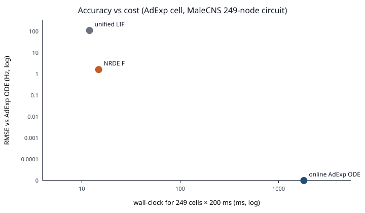
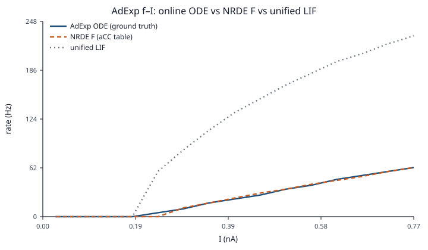
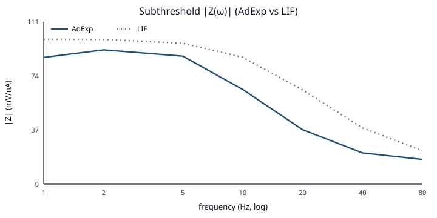

# NRDE — Neuron Reduced-Dynamics Engine

连接组进，类型绑定的降阶激活函数 \(F\) 出。仿真主循环做稀疏传播并查 \(F\)，不再逐步积分 HH / AdExp。

果蝇 MaleCNS 是当前实例预设，不是引擎的全部范围。  
**不是**完整生物物理重建，**不**主张有意义行走行为（[RFC-001 宣传口径](docs/rfcs/RFC-001.md)）。

## 为什么存在

在线 ODE（FlyBrainLab 一类）准，但主循环太贵。统一 LIF（Shiu 一类）快，但所有细胞共用一条曲线。NRDE 把单胞 ODE **离线**拟合成按类型绑定的 \(F\)，运行时走查表。

默认数据集上的实测（AdExp 细胞 `aCC`，相对在线 Euler；回路为 MaleCNS 附属屈肌运动神经元 249 点）：

| 方法 | 相对 AdExp ODE | 249 细胞 × 200 ms |
|---|---|---|
| 在线 AdExp ODE | 定义上的 ground truth | ~1.8 s（8 细胞外推） |
| **NRDE \(F\)** | \(R^2=0.995\)，RMSE **1.6 Hz** | **~15 ms**（约 120×） |
| 统一 LIF | 同一 \(I\) 上发放高一个量级，RMSE **110 Hz** | ~12 ms |

硬件：证据链记录为 AMD Ryzen 7 5800X、NumPy 引擎。墙钟会随机器变；精度在同一协议下应可复现。





左图：ODE 准而慢，LIF 快但偏，\(F\) 贴着 ODE 的精度、贴着 LIF 的代价。右图：虚线（\(F\)）叠在实线（AdExp ODE）上；点线是默认 LIF。



稳态对准不等于频域对准。这组 AdExp 在默认 chirp 协议下没有内点谐振峰（拟合器仍因适应把 `aCC_l0.npz` 标成 L1）。协议、哈希、复现命令：[证据链](docs/reports/evidence.md)。

和现有项目的关系：FlyBrainLab / Neurokernel 在线积 HH；ornata/fly 用通用激活；Shiu et al. 2024 用统一 LIF + 固定 \(W_\mathrm{syn}\)（NRDE 把该值当 α **初值**，并按类型绑 \(F\)）。

## 5 分钟

本地开发不要 `pip install` 进系统 Python。uv 把包装进仓库下的 `.venv`，命令一律 `uv run`。

```bash
git clone https://github.com/NACXA0/NeuronReducedDynamicsEngine.git
cd NeuronReducedDynamicsEngine
uv sync
uv run --no-sync nrde fetch fly --tier pretrained
uv run --no-sync nrde run simulate \
  --fit datasets/fly/fits/aCC_l0.npz \
  --n 80 --steps 50
```

`fetch --tier pretrained` 校验 `datasets/fly/` 里 33 个表文件的 sha256。预训练是两步：先有 \(F\)（已经在 `fits/`），再稀疏传播。传播不是再训练。

果蝇具身 Demo、自己拟合 L0–L2、从源码装齐 extras，分别在下面，不堆在这一页。

## 接下来

| 想做的事 | 文档 |
|---|---|
| 果蝇 Demo（Colab / `nrde demo flygym`） | [快速开始：Demo](docs/quickstart/demo.md) |
| 在默认回路上做稀疏传播 | [快速开始：引擎](docs/quickstart/engine.md) |
| 自己拟合 L0 / L1 / L2 | [快速开始：拟合 F](docs/quickstart/pipeline.md) |
| 从源码开发、extras、MaleCNS 全量 | [从源码构建](docs/from_source.md) |
| 数字怎么来的 | [证据链](docs/reports/evidence.md) |

贡献约定（命名、测试）见 [CONTRIBUTING.md](CONTRIBUTING.md)。许可证：[Apache License 2.0](LICENSE)。
